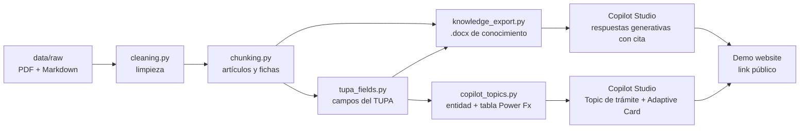

# Chatbot de normatividad estudiantil UCSM

Asistente conversacional que orienta a los estudiantes de la Universidad
Católica de Santa María (UCSM) sobre dos documentos oficiales:

- el **Texto Único Ordenado del Reglamento de Estudiantes** (Res. N°
  9814-CU-2026): qué dice la norma;
- el **Texto Único de Procedimientos Administrativos (TUPA)** (Res. N°
  9888-CU-2026): cómo, cuánto, cuándo y dónde se tramita.

El agente se construye en **Microsoft Copilot Studio**. Este repositorio
contiene la preparación del corpus (Python), el protocolo conversacional,
los artefactos que se cargan en el agente y la evaluación. Es un proyecto
académico de la Maestría (curso de Herramientas de IA).

> **Aviso:** es un asistente de orientación, no un canal oficial de la
> UCSM. El texto vinculante es el de los documentos publicados en
> https://ucsm.edu.pe/normatividad/.

## Arquitectura



- Las **preguntas normativas** se responden con respuestas generativas
  restringidas a los dos documentos de conocimiento, citando el artículo o
  el código del procedimiento.
- Los **montos y plazos de trámites** se muestran desde una tabla generada a
  partir del TUPA, por lo que son exactos por construcción.

## Estado

| Etapa | Estado |
|---|---|
| Alcance | Completo |
| Protocolo conversacional (mensajes, diagrama, guion) | Completo |
| Preparación del corpus (159/159 artículos, 63/63 fichas) | Completo |
| Agente en Copilot Studio | Publicado en *Demo website* sin autenticación; solución 1.0.0.4 |
| Evaluación del banco (44 preguntas, ronda 4) | 44 correctas, 0 alucinadas; p90 12,3 s (meta < 10 s, no cumple). Falta la revisión por una segunda persona |
| Prueba de usabilidad (9 participantes) | SUS 85,8 (meta ≥ 68) |

## Requisitos

- Python 3.13
- Para regenerar el diagrama del protocolo: Node.js (`npx`)

## Instalación

```bash
python3.13 -m venv .venv
```

```bash
.venv/bin/pip install -r requirements.txt
```

## Uso

Generar todos los artefactos del corpus con un solo comando (es
determinista: dos ejecuciones producen archivos idénticos):

```bash
PYTHONPATH=src .venv/bin/python -m ucsm_bot.build
```

Ejecutar las pruebas:

```bash
.venv/bin/python -m pytest
```

Otros comandos:

| Comando | Qué hace |
|---|---|
| `.venv/bin/python eval/check_questions.py` | Verifica los mínimos del banco de preguntas y que montos y plazos coincidan con el TUPA |
| `.venv/bin/python eval/compute_metrics.py` | Calcula las métricas desde `eval/results.csv` y escribe `eval/reporte.md` |
| `.venv/bin/python eval/compute_sus.py` | Calcula el SUS y las métricas de tareas desde `eval/sus.csv` y `eval/tareas.csv` |
| `.venv/bin/python scripts/generate_copilot_topics.py` | Regenera solo la entidad y la tabla Power Fx desde `tupa.json` |
| `scripts/publish_wiki.sh` | Publica `docs/wiki/` y las figuras en la Wiki de GitHub (`--no-push` para revisar antes) |

## Estructura

```
.
├── README.md
├── pyproject.toml
├── requirements.txt            python-docx, pyyaml, pytest
├── data/
│   ├── inventory.csv           metadatos de los 2 documentos
│   ├── raw/                    PDF oficiales y su conversión a Markdown
│   └── processed/              salida de ucsm_bot.build: texto limpio,
│                               units.jsonl, chunks.jsonl, tupa.json e
│                               ingest_report.md
├── src/ucsm_bot/
│   ├── corpus.py               rutas e inventario de documentos
│   ├── cleaning.py             limpieza y reconstrucción de páginas
│   ├── chunking.py             segmentación en artículos y fichas
│   ├── tupa_fields.py          campos de cada ficha del TUPA
│   ├── knowledge_export.py     .docx y .csv de conocimiento
│   ├── copilot_topics.py       entidad y tabla Power Fx del TUPA
│   ├── copilot_dialogs.py      YAML de los Topics desde protocolo.yaml
│   ├── evaluation.py           métricas del banco y SUS
│   └── build.py                comando único de generación
├── scripts/
│   ├── generate_copilot_topics.py   regenera solo la entidad y la tabla
│   └── publish_wiki.sh              publica docs/wiki/ en la Wiki de GitHub
├── copilot/
│   ├── instructions.md         instrucciones del agente
│   ├── knowledge/              documentos cargados en Knowledge
│   ├── topics/                 Topics (YAML), entidad y tabla Power Fx
│   └── solution/               solución exportada (versión 1.0.0.4)
├── docs/
│   ├── alcance.md
│   ├── analisis_corpus.md
│   ├── protocolo.md, protocolo.yaml
│   ├── guion_verificacion.md
│   ├── bitacora.md             decisiones, iteraciones y versiones
│   ├── figuras/                diagrama del protocolo y capturas del agente
│   └── wiki/                   páginas de la Wiki de GitHub
├── eval/
│   ├── questions.yaml, check_questions.py      banco de preguntas
│   ├── run_bank.py, to_results.py              ejecución por Direct Line
│   ├── transcripts.jsonl, calificacion.json,
│   │   results.csv                             datos de la ronda 4
│   ├── compute_metrics.py, reporte.md, rubrica.md
│   ├── evaluacion_completa.md                  método y rondas 1–4
│   ├── tareas_usabilidad.md, formulario_sus.md,
│   │   forms_to_sus.py, compute_sus.py         prueba de usabilidad
│   ├── sus.csv, tareas.csv, usabilidad.md      resultados del SUS
│   └── analitica.md                            analítica de Copilot Studio
└── tests/                      limpieza, segmentación, campos del TUPA,
                                artefactos generados y evaluación
```

## Documentación

- [Alcance](docs/alcance.md)
- [Análisis del corpus](docs/analisis_corpus.md)
- [Protocolo conversacional](docs/protocolo.md) y sus mensajes en
  [`protocolo.yaml`](docs/protocolo.yaml)
- [Guion de verificación](docs/guion_verificacion.md)
- [Reporte de ingesta](data/processed/ingest_report.md)
- [Instrucciones del agente](copilot/instructions.md)
- [Evaluación](eval/README.md): [resultados del banco](eval/evaluacion_completa.md)
  y [usabilidad](eval/usabilidad.md)
- [Bitácora](docs/bitacora.md)
- [Wiki](docs/wiki/Home.md): resumen del proyecto para la Wiki de GitHub

## Fuentes

- Universidad Católica de Santa María. (2026). *Texto Único Ordenado del
  Reglamento de Estudiantes de la UCSM* (Resolución N° 9814-CU-2026).
  https://www.ucsm.edu.pe/wp-content/uploads/documentos/reglamentos/RES_9814-CU-2026.pdf
- Universidad Católica de Santa María. (2026). *Texto Único de
  Procedimientos Administrativos (TUPA)* (Resolución N° 9888-CU-2026).
  https://www.ucsm.edu.pe/wp-content/uploads/documentos/reglamentos/RES_9888-CU-2026-TUPA.pdf

Los documentos pertenecen a la UCSM y se incluyen solo como corpus del
proyecto académico.
