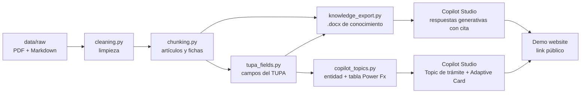

# Chatbot de normatividad estudiantil UCSM

Asistente conversacional que orienta a los estudiantes de la Universidad
Católica de Santa María (UCSM) sobre dos documentos oficiales:

- el **Texto Único Ordenado del Reglamento de Estudiantes** (Res. N°
  9814-CU-2026): qué dice la norma;
- el **Texto Único de Procedimientos Administrativos (TUPA)** (Res. N°
  9888-CU-2026): cómo, cuánto, cuándo y dónde se tramita.

El agente se construye en **Microsoft Copilot Studio**. Este repositorio
contiene la preparación del corpus (Python), el protocolo conversacional,
los artefactos que se cargan en el agente y la evaluación. Es un proyecto
académico de la Maestría (curso de Herramientas de IA).

> **Aviso:** es un asistente de orientación, no un canal oficial de la
> UCSM. El texto vinculante es el de los documentos publicados en
> https://ucsm.edu.pe/normatividad/.

## Arquitectura



- Las **preguntas normativas** se responden con respuestas generativas
  restringidas a los dos documentos de conocimiento, citando el artículo o
  el código del procedimiento.
- Los **montos y plazos de trámites** se muestran desde una tabla generada a
  partir del TUPA, por lo que son exactos por construcción.

## Estado

| Etapa | Estado |
|---|---|
| Alcance, revisión de literatura y matriz de plataformas | Completo |
| Protocolo conversacional (mensajes, diagrama, guion) | Completo; falta la validación con usuarios |
| Preparación del corpus (159/159 artículos, 63/63 fichas) | Completo |
| Banco de preguntas, métricas, rúbrica y SUS | Preparado; se ejecuta con el agente publicado |
| Agente en Copilot Studio | Pendiente de verificar el acceso con la cuenta del autor |
| Evaluación y paper | Pendiente |

## Requisitos

- Python 3.13
- Para regenerar el diagrama del protocolo: Node.js (`npx`)

## Instalación

```bash
python3.13 -m venv .venv
```

```bash
.venv/bin/pip install -r requirements.txt
```

## Uso

Generar todos los artefactos del corpus con un solo comando (es
determinista: dos ejecuciones producen archivos idénticos):

```bash
PYTHONPATH=src .venv/bin/python -m ucsm_bot.build
```

Ejecutar las pruebas:

```bash
.venv/bin/python -m pytest
```

Otros comandos:

| Comando | Qué hace |
|---|---|
| `.venv/bin/python eval/check_questions.py` | Verifica los mínimos del banco de preguntas y que montos y plazos coincidan con el TUPA |
| `.venv/bin/python eval/compute_metrics.py` | Calcula las métricas desde `eval/results.csv` y escribe `eval/reporte.md` |
| `.venv/bin/python eval/compute_sus.py` | Calcula el SUS y las métricas de tareas desde `eval/sus.csv` y `eval/tareas.csv` |
| `.venv/bin/python scripts/compute_platform_matrix.py` | Recalcula la matriz ponderada de plataformas y su análisis de sensibilidad |
| `.venv/bin/python scripts/generate_copilot_topics.py` | Regenera solo la entidad y la tabla Power Fx desde `tupa.json` |

## Estructura

```
data/raw/              PDF oficiales y su conversión a Markdown
data/inventory.csv     metadatos de los 2 documentos
data/processed/        texto limpio, unidades y fragmentos (JSONL), tupa.json,
                       reporte de ingesta
src/ucsm_bot/          limpieza, segmentación, campos del TUPA, exportación,
                       evaluación y comando build
scripts/               matriz de plataformas y tablas para Topics
copilot/               instrucciones del agente, documentos de conocimiento,
                       entidad y tabla Power Fx, solución exportada
docs/                  alcance, revisión de literatura, matriz, protocolo,
                       guion de verificación, validación, bitácora, figuras
eval/                  banco de preguntas, métricas, rúbrica, usabilidad
tests/                 pruebas de limpieza, segmentación, campos y evaluación
paper/                 paper (plantilla TAF)
```

## Documentación

- [Alcance](docs/alcance.md)
- [Análisis del corpus](docs/analisis_corpus.md)
- [Revisión de literatura](docs/revision_literatura.md)
- [Matriz de selección de plataforma](docs/matriz_plataformas.md)
- [Protocolo conversacional](docs/protocolo.md) y sus mensajes en
  [`protocolo.yaml`](docs/protocolo.yaml)
- [Guion de verificación](docs/guion_verificacion.md)
- [Reporte de ingesta](data/processed/ingest_report.md)
- [Instrucciones del agente](copilot/instructions.md)
- [Evaluación](eval/README.md)
- [Bitácora](docs/bitacora.md)

## Fuentes

- Universidad Católica de Santa María. (2026). *Texto Único Ordenado del
  Reglamento de Estudiantes de la UCSM* (Resolución N° 9814-CU-2026).
  https://www.ucsm.edu.pe/wp-content/uploads/documentos/reglamentos/RES_9814-CU-2026.pdf
- Universidad Católica de Santa María. (2026). *Texto Único de
  Procedimientos Administrativos (TUPA)* (Resolución N° 9888-CU-2026).
  https://www.ucsm.edu.pe/wp-content/uploads/documentos/reglamentos/RES_9888-CU-2026-TUPA.pdf

Los documentos pertenecen a la UCSM y se incluyen solo como corpus del
proyecto académico.
