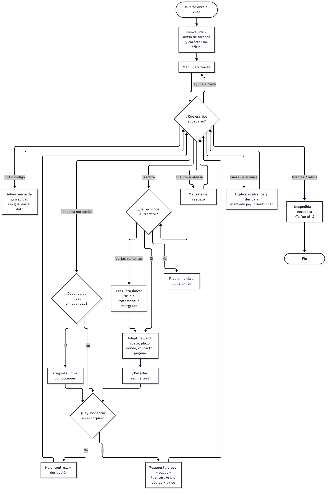

# Protocolo conversacional

Asistente de normatividad estudiantil de la UCSM. Corpus: TUO del Reglamento
de Estudiantes (Res. 9814-CU-2026) y TUPA (Res. 9888-CU-2026).

Los textos fijos (bienvenida, menú, avisos, preguntas de desambiguación,
despedida) están en [`protocolo.yaml`](protocolo.yaml), que es la **fuente
única**. Este documento explica el diseño; si un texto difiere, manda el
YAML.

## 1. Principios

- **Claro y breve:** respuestas de hasta ~150 palabras, en español formal y
  sencillo, con viñetas o pasos numerados.
- **Siempre con fuente:** cada respuesta normativa termina con
  "Fuentes:" y el artículo (Reglamento) o el código de procedimiento (TUPA)
  con su página.
- **Una sola pregunta de aclaración:** si la respuesta depende del nivel,
  la modalidad o de qué trámite se trata, se pregunta una vez con opciones
  concretas.
- **Sin datos personales:** el asistente no pide ni procesa DNI, código,
  notas ni contraseñas.
- **No oficial:** el aviso de carácter no oficial está en la bienvenida, en
  la descripción del agente y al final de las respuestas normativas.

## 2. Flujo



Fuente del diagrama: [`figuras/protocolo_flujo.mmd`](figuras/protocolo_flujo.mmd).

## 3. Tabla de intenciones

| Intención | Topic en Copilot Studio | Mensajes ejemplo | Respuesta |
|---|---|---|---|
| Saludo | Conversation Start (sistema) | "hola", "buenos días" | Bienvenida + aviso de alcance + menú (`saludo`) |
| Ayuda / menú | Menú de temas | "ayuda", "¿qué puedes hacer?" | Menú de 7 temas con *quick replies* (`menu`) |
| Consulta normativa | Respuesta generativa sobre `reglamento_estudiantes.docx` | "¿Qué pasa si desapruebo un curso tres veces?" | Respuesta breve con cita del artículo (Art. 83°, pág. 24) |
| Consulta de trámite | Consulta de trámite | "¿Cuánto cuesta la anulación de matrícula?" | Adaptive Card con costo, plazo, dónde y contacto (`consulta_tramite`) + oferta de requisitos |
| Consulta combinada | Respuesta generativa (ambos documentos) | "Falté a un examen por enfermedad, ¿qué hago?" | Regla (Art. 74°) + trámite TUPA tras desambiguar la escuela |
| Desambiguación de trámite | Evaluación extemporánea | "¿Cómo pido una evaluación extemporánea?" | Pregunta Escuela Profesional / Escuela de Postgrado (PA1130732571 / PA1130731912) |
| Desambiguación de nivel o modalidad | Instrucción del agente | "¿Cuántos créditos puedo llevar?" | Pregunta pregrado/postgrado o presencial/semipresencial/a distancia |
| Datos personales | Datos personales (entidad regex 8 o 10 dígitos) | "mi DNI es 45678912" | Advertencia y retoma de la consulta (`datos_personales`) |
| Fuera de alcance | Fallback (sistema) | "¿Cuál es mi nota?", "admisión", "reglamento docente" | Explica el alcance y deriva a https://ucsm.edu.pe/normatividad/ (`fuera_de_alcance`) |
| Sin evidencia | Respuesta generativa sin resultados | pregunta del dominio sin respuesta en el corpus | "No encontré…" + derivación (`sin_evidencia`) |
| Contenido inapropiado | Moderación de contenido (sistema) | insultos, contenido ofensivo | Mensaje de respeto y retoma (`contenido_inapropiado`) |
| Agradecimiento / despedida | End of Conversation (sistema) | "gracias, eso es todo" | Despedida + encuesta "¿Te fue útil?" (`despedida`) |

Los identificadores entre paréntesis son los `id` de `protocolo.yaml`.

## 4. Desambiguación

1. **Trámite con variantes:** el TUPA tiene trámites casi iguales por
   escuela. El caso de referencia es la evaluación extemporánea: el Topic
   pregunta la escuela y muestra la ficha correspondiente.
2. **Nivel y modalidad:** las instrucciones del agente le piden preguntar
   una sola vez "¿pregrado o postgrado?" o "¿presencial, semipresencial o a
   distancia?" cuando la regla cambia según eso.
3. **Trámite no reconocido:** si la entidad `Procedimiento TUPA` no
   reconoce el nombre, el Topic pide el nombre del trámite con un ejemplo.
4. **Varias fichas igual de probables:** si la búsqueda del Topic *Consulta
   de trámite* empata entre fichas de nombre parecido (por ejemplo "copia
   autenticada de mi título": acta de grados o resolución del título), el
   agente las lista con código, costo y plazo (hasta cuatro) y pregunta
   cuál; el usuario responde con el número, el código o el nombre
   (`varias_fichas` y `pregunta_cual`). Se agregó después de la prueba de
   usabilidad, donde el agente elegía una sin preguntar.

## 5. Formato de respuesta

```
<respuesta directa en 1–2 frases>

1. <paso o requisito>
2. <paso o requisito>

Fuentes: Reglamento de Estudiantes, Art. 83° (pág. 24)
Orientación no oficial; el texto vinculante es el documento oficial.
```

Para trámites, la Adaptive Card muestra: denominación, código, costo, plazo
de atención, dónde se presenta, contacto y páginas del TUPA. Los valores
salen de `copilot/topics/tabla_tupa.powerfx`, generada desde
`data/processed/tupa.json`, por lo que coinciden con el documento.

## 6. Aviso y privacidad

- Aviso no oficial: `avisos.no_oficial` en la bienvenida y en la
  descripción del agente (visible en el Demo website).
- Privacidad: el Topic `Datos personales` se activa con frases ("mi DNI
  es…") o con la entidad regex de 8 dígitos (DNI) o 10 dígitos (código de
  estudiante). Responde con `datos_personales.mensaje` y no guarda el dato
  en variables.

## 7. Cobertura de los requisitos de `conversation-protocol`

| Requisito | Dónde se cumple |
|---|---|
| Bienvenida y presentación del alcance | `saludo`, `avisos.alcance`, `menu` |
| Clasificación de intenciones | Tabla de intenciones (sección 3) |
| Desambiguación | Sección 4, `desambiguacion_*` |
| Formato de respuesta | Sección 5, `formatos.respuesta_normativa` |
| Aviso de carácter no oficial | `avisos.no_oficial`, sección 6 |
| Privacidad | `datos_personales`, sección 6 |
| Fuente única de mensajes | `protocolo.yaml` + `guion_verificacion.md` |
| Validación del protocolo | Diagrama (sección 2) + guion de verificación, iteraciones (`eval/iteraciones.md`) y banco de preguntas (`eval/evaluacion_completa.md`) |
