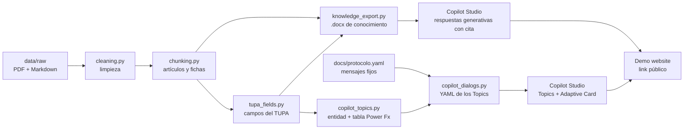

# Arquitectura

El repositorio prepara en Python todo lo que se carga en Copilot Studio. El
agente combina dos mecanismos:

- Las **preguntas normativas** se responden con respuestas generativas
  restringidas a los dos documentos de conocimiento, citando el artículo o
  el código del procedimiento.
- Los **montos y plazos de trámites** se muestran en una Adaptive Card desde
  una tabla Power Fx generada a partir del TUPA, por lo que son exactos por
  construcción.

## Componentes

| Módulo (`src/ucsm_bot/`) | Función |
|---|---|
| `corpus.py` | Rutas del proyecto e inventario de los documentos (`data/inventory.csv`) |
| `cleaning.py` | Quita índice, encabezados, pies y avisos repetidos; reconstruye la página de cada línea |
| `chunking.py` | Segmenta el Reglamento por artículo y el TUPA por ficha |
| `tupa_fields.py` | Extrae de cada ficha código, costo, plazo, unidades, contacto y páginas |
| `knowledge_export.py` | Escribe los `.docx` y el `.csv` que se cargan en *Knowledge* |
| `copilot_topics.py` | Genera la entidad de procedimientos y la tabla Power Fx del TUPA |
| `copilot_dialogs.py` | Genera el YAML de los Topics a partir de `docs/protocolo.yaml` |
| `evaluation.py` | Métricas del banco de preguntas y cálculo del SUS |
| `build.py` | Comando único que genera todos los artefactos |

## Decisiones principales

- **Plataforma low-code en la nube:** Copilot Studio ofrece respuestas
  generativas sobre documentos propios, Topics con Adaptive Cards,
  publicación con link sin autenticación y analítica integrada.
- **Markdown como fuente, PDF para verificar:** el `.md` conserva el orden
  de lectura de las fichas; el PDF se usa para comprobar páginas y tablas.
  No hace falta OCR.
- **Conocimiento en `.docx`:** los encabezados guían la segmentación de
  Copilot Studio. Cada párrafo del Reglamento empieza con su artículo
  ("Art. 136°: …") para que la cita no se confunda con un artículo vecino.
- **Datos exactos fuera del modelo:** costo y plazo salen de la tabla Power
  Fx, no de la respuesta generativa.
- **Mensajes en un solo lugar:** `docs/protocolo.yaml` es la fuente de los
  textos fijos; los Topics se generan desde él.
- **Generación determinista:** dos ejecuciones del build producen archivos
  idénticos, y las pruebas verifican los artefactos.
